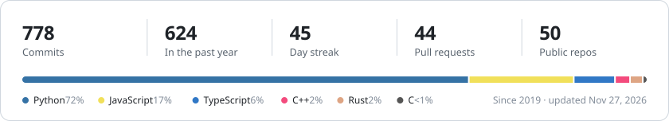
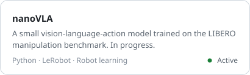
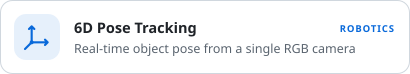
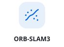
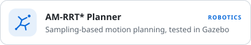
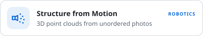
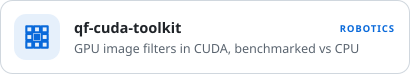
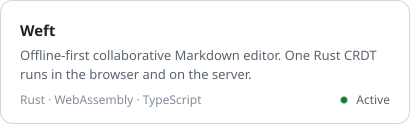
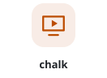

<!-- Edit TEMPLATE.md and profile.json, not README.md. README.md and assets/ are regenerated daily by .github/workflows/update-readme.yml · last run 27 Nov 2026 -->

<picture><source media="(prefers-color-scheme: dark)" srcset="assets/header-dark.svg"></picture>

### Projects

<a href="https://github.com/irfanalimd/nanovla"><picture><source media="(prefers-color-scheme: dark)" srcset="assets/projects/nanovla-dark.svg"></picture></a> <a href="https://github.com/irfanalimd/6D-pose-tracking-system"><picture><source media="(prefers-color-scheme: dark)" srcset="assets/projects/6D-pose-tracking-system-dark.svg"></picture></a>
<a href="https://github.com/irfanalimd/ORB-SLAM-3-using-ROS"><picture><source media="(prefers-color-scheme: dark)" srcset="assets/projects/ORB-SLAM-3-using-ROS-dark.svg"></picture></a> <a href="https://github.com/irfanalimd/AM-RRT-motion-planning-algorithm"><picture><source media="(prefers-color-scheme: dark)" srcset="assets/projects/AM-RRT-motion-planning-algorithm-dark.svg"></picture></a>
<a href="https://github.com/irfanalimd/structure-from-motion"><picture><source media="(prefers-color-scheme: dark)" srcset="assets/projects/structure-from-motion-dark.svg"></picture></a> <a href="https://github.com/irfanalimd/qf-cuda-toolkit"><picture><source media="(prefers-color-scheme: dark)" srcset="assets/projects/qf-cuda-toolkit-dark.svg"></picture></a>
<a href="https://github.com/irfanalimd/VLM-Bias-Detection-with-Chain-of-Thought-Reasoning"><picture><source media="(prefers-color-scheme: dark)" srcset="assets/projects/VLM-Bias-Detection-with-Chain-of-Thought-Reasoning-dark.svg"></picture></a> <a href="https://github.com/irfanalimd/Image-Captioning-with-Vision-Transformer-and-GPT-2-"><picture><source media="(prefers-color-scheme: dark)" srcset="assets/projects/Image-Captioning-with-Vision-Transformer-and-GPT-2--dark.svg"></picture></a>
<a href="https://github.com/irfanalimd/weft"><picture><source media="(prefers-color-scheme: dark)" srcset="assets/projects/weft-dark.svg"></picture></a> <a href="https://github.com/irfanalimd/chalk"><picture><source media="(prefers-color-scheme: dark)" srcset="assets/projects/chalk-dark.svg"></picture></a>
<a href="https://github.com/irfanalimd/explainer"><picture><source media="(prefers-color-scheme: dark)" srcset="assets/projects/explainer-dark.svg"></picture></a> <a href="https://github.com/irfanalimd/robinhood-portfolio-dashboard"><picture><source media="(prefers-color-scheme: dark)" srcset="assets/projects/robinhood-portfolio-dashboard-dark.svg"></picture></a>

### Stack

<picture><source media="(prefers-color-scheme: dark)" srcset="assets/stack-dark.svg"></picture>
